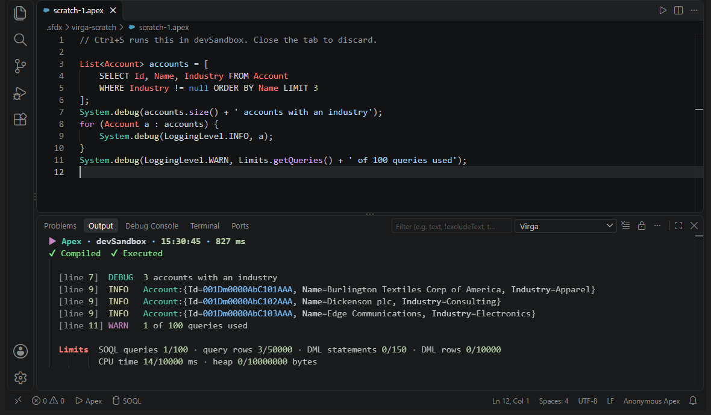
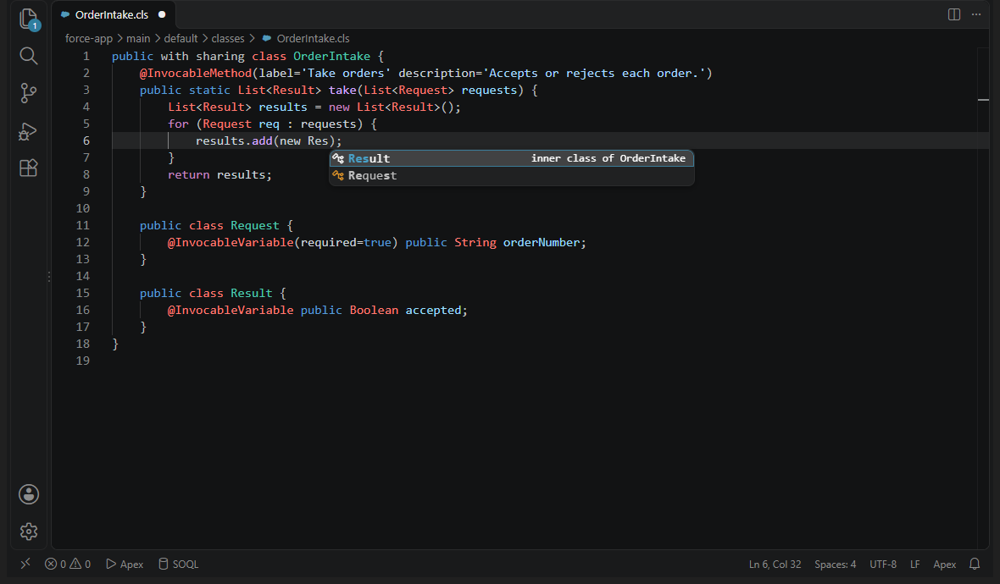
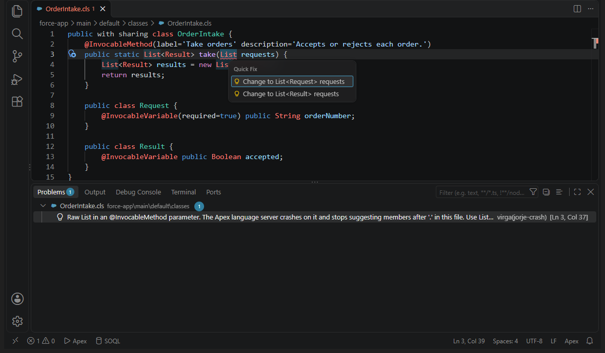

# Virga: Apex Scratch & Quick Fixes

Run Apex and SOQL from a scratch tab with **Ctrl+S**. Plus local type completion,
quick fixes and snippets. Works with Salesforce CLI and the Salesforce Extension Pack.

*Virga* is rain that evaporates before it reaches the ground. The code you try
out in a scratch never lands in your project either.

- [Install](#install) · [Features](#features)
- [Keyboard shortcuts](#keyboard-shortcuts) · [Commands](#commands) · [Settings](#settings)
- [Requirements](#requirements) · [Privacy](#privacy) · [Known limitations](#known-limitations) · [FAQ](#faq)
- [Contributing](#contributing) · [License](#license)

## Install

- VS Code: [Visual Studio Marketplace](https://marketplace.visualstudio.com/items?itemName=WiktorMayska.virga),
  or `code --install-extension WiktorMayska.virga`
- Cursor, VSCodium, Windsurf and other Open VSX editors:
  [Open VSX](https://open-vsx.org/extension/WiktorMayska/virga)
- Any VS Code build: the `.vsix` from [GitHub Releases](https://github.com/wiktormalyska/virga/releases),
  then **Extensions: Install from VSIX...**

## Features

### Apex and SOQL scratches



- Two buttons in the status bar of a Salesforce DX project (a folder with
  `sfdx-project.json`): **▷ Apex** and **SOQL** (with a database icon). Each click
  opens a new tab: `scratch-1.apex`, `scratch-2.apex`, `scratch-1.soql`, …
- **Ctrl+S** (Cmd+S on macOS) in a scratch runs it in the project's default org:
  `.apex` with `sf apex run`, `.soql` with `sf data query`. The org is the one
  `sf` itself would pick (`SF_TARGET_ORG`, then the project's `.sf/config.json`,
  then your global config), and it is passed to `sf` as `--target-org`, so the
  header of the result always names the org the code really ran in.
- The result lands in the **Virga** output channel, colored:
  - Apex: `✔ Compiled ✔ Executed`, every `System.debug` as
    `[line 12] DEBUG message` with its log level, then the limits you used
    (SOQL queries, rows, DML, CPU, heap). A compile error or an exception shows
    the offending line with a `^` under the spot; an exception also gets its
    stack trace and the debug lines written before it.
  - SOQL: the record count and a table. Relationship fields are flattened
    (`Account.Owner.Name`), subqueries show as `[2 rows]`, long values end
    with `…`. Columns come from the query too, so a relationship that is empty
    in every row keeps its columns instead of collapsing into one `null`.
- Closing the tab discards the scratch. VS Code never asks whether to save it.
- A scratch is a real file in `.sfdx/virga-scratch/` (`.sfdx/` is git-ignored in
  Salesforce DX projects), so the Apex and SOQL language servers of the
  Salesforce Extension Pack complete and underline it like any other file.

What runs is exactly the text you see when you press Ctrl+S. Virga hands `sf`
a copy of it in a temporary folder, never the scratch file itself and never on
the command line. Keys you type after Ctrl+S are not part of that run, and no
save, auto save or **Save All** from another file ever runs a scratch: only
Ctrl+S in the scratch, the ▶ button in its editor title, or **Virga: Run
Scratch** does. A second Ctrl+S during a run is queued (one run at a time); the
queued text is replaced by a newer Ctrl+S in the same tab.

How a scratch avoids the "save changes?" question: Virga sets a short auto
save (`afterDelay`, 100 ms) as the default for the `apex-anon` and `soql`
languages. With such a short delay VS Code treats the tab as "being saved": no
dirty dot, closing never asks, and closing the window saves instead of asking.
If a background save fails (another program locks the file, the disk is full)
Virga retries it with a growing pause, up to 5 seconds, until it succeeds.

A scratch lives as long as the window that created it. Tabs that VS Code
restores after a restart are closed and discarded at startup without a
question, except those another open window still shows and those of the same
window after **Developer: Reload Window**. Two windows on the same project
never delete each other's scratches. Files left behind by a crash are removed
at the next start once they are older than 5 minutes.

### Completion for types declared in the same file



The Apex language server does not complete the simple name of a type declared
in the same file. Virga suggests every class, interface and enum of the
current file (top-level and inner, any depth), next to what the language
server returns, with a detail such as `inner class of OrderIntake`.

- It stays silent where the language server owns the position: after a dot,
  in comments and strings, after `@`, while you name a new type, and inside
  inline SOQL / SOSL (`[SELECT … FROM Re|]`). Bind expressions
  (`WHERE Name = :re|`) are Apex, so local types are offered there.
- In a saved `.cls` the file's own top-level class is left out (the language
  server already offers it), so it never shows up twice.
- It only returns names the editor can match against what you typed, so where
  nothing matches VS Code's word-based suggestions still appear.

### Signatures that break completion, with a quick fix



Some method signatures make the Apex language server stop suggesting members
after `.`, and all it shows is a misleading syntax error, never the cause.
Virga flags the cause as an error (source `virga`) and offers a quick fix
(**Ctrl+.**) that inserts the type:

- **`jorje-crash`, the whole file.** For methods with `@InvocableMethod`,
  static `@AuraEnabled`, `@HttpGet` / `@HttpPost` and the other `@Http*`
  annotations, `webservice` and `global` methods, the language server unpacks
  the element type of every `List`, `Set` and `Map` parameter. A collection
  without type arguments (raw `List`, `List<>`, `List<Req` while you type) or
  with the wrong number of them throws inside the server; the file is left
  without resolved types and completion after `.` stops in every method. An
  empty argument slot (`List< >`, `List<String, >`) does the same in any
  method.
- **`jorje-parse`, that method.** A raw `List` / `Set` / `Map`, `List<>` or
  `List<List>` as the return type makes the parser drop the whole method. So
  does a parameter cut off right after `<` or a comma (`List<)`), or a raw
  collection right before `{` when the `)` is missing.

The quick fix picks the type from the file: in an `@InvocableMethod`
parameter an inner class with `@InvocableVariable` fields (Request / Input
style names first), in an `@AuraEnabled` one a class with `@AuraEnabled`
fields, in a return type the output class (Response / Result / Output, even an
empty one), else `List<String>` or `Map<String, Object>` and the title says
why. It completes an unfinished `List<Req`, names a parameter that has no name
(`List<Request> requests`) and adds a missing `)`. It replaces only the type,
so comments and line breaks in the signature stay where they are. A fix is
marked preferred only when the choice is unambiguous; with two equally good
classes you get both.

The checks are deliberately narrow. Only shapes that broke the language server
in a measurement are flagged: 274 signatures run through the same server jar
with the same flags as in VS Code, and the checks agree with the measurement
in every one of them. After the quick fix the server threw in none of the 184
breaking cases, and completion after `.` came back in 180 of the 181 where it
had been empty (the exception: `@InvocableMethod` on an interface method,
which the parser rejects anyway). Shapes that measured clean stay silent, even
if they are syntax errors.
Diagnostics appear 400 ms after you stop typing, go away when the file is
closed, and skip anonymous Apex and files under `.sfdx/` (generated, read-only
copies).

### Apex and SOQL snippets

The Apex language server completes neither annotations nor keywords: after
`@` it returns every symbol it knows (`@Aura` gives `AuraDefinition` rather than
`AuraEnabled`), and after `ret` it offers type names such as `ReturnOrder`, not
`return`. The Salesforce Extension Pack fills part of that gap with snippets
for the common statements: `if`, `ifelse`, `else`, `for`, `fori`, `while`,
`do`, `try`, `tryf`, `switch`, `class`, `interface`, `enum`, `throw`,
`dbquery`, `select…` and more. Virga does not repeat those. None of its
prefixes is one the pack uses (checked against Extension Pack 67.26), so a
suggestion list never shows the same name twice. Virga adds what the pack
lacks, for the `apex` language:

- **Annotations**, after the list in the Apex Developer Guide: `AuraEnabled`
  (also `cacheable=true`), `InvocableMethod` (label, description, category;
  also `callout=true`), `InvocableVariable`, `IsTest` (with `SeeAllData`,
  `IsParallel`), `TestSetup`, `TestVisible`, `future`, `RestResource`, the
  `Http*` methods, `JsonAccess`, `SuppressWarnings('PMD.…')` and more. Prefix
  and body leave out the `@`, because VS Code does not count `@` as part of a
  word: type `@`, then `Inv`, and the snippet inserts `InvocableMethod(…)`
  after your `@`.
- **Keywords the pack has no snippet for**: `return`, `break`, `continue`,
  `else if`, `new`, `instanceof`, `null`, `true`, `false`, `this`; access,
  sharing and other modifiers (`public`, `global`, `with sharing`,
  `inherited sharing`, `static`, `final`, `virtual`, `override`,
  `transient`, …), `implements`, `extends`; and the DML statements `insert`,
  `update`, `upsert`, `delete`, `undelete`.
- **User and system mode**: `insert as user` and the other DML forms,
  `Database.insert(…, AccessLevel.USER_MODE)` (`dbuser`),
  `Database.queryWithBinds` in user mode (`dbqueryuser`; the pack's `dbquery`
  is a plain `Database.query`), and `WITH USER_MODE` / `WITH SYSTEM_MODE`.
  The SOQL language server does not offer these clauses (after `WITH` it only
  suggests `DATA CATEGORY`), so the SOQL ones also work in `.soql` files and
  inside `[SELECT …]` in a class. `WITH SECURITY_ENFORCED` is not offered: it
  does not compile from API version 67.0, and its prefix inserts `USER_MODE`
  instead.

Snippets sort among the other suggestions (`"editor.snippetSuggestions":
"inline"`, VS Code's default). With `"top"`, Ctrl+Space inside `[SELECT …]`
would list snippets above the object's fields.

## Keyboard shortcuts

| Key | Where | What it does |
|---|---|---|
| **Ctrl+S** (Cmd+S) | a scratch editor | runs the scratch (`virga.scratch.run`) |
| **Ctrl+.** (Cmd+.) | on a flagged signature | VS Code's quick fix: inserts the collection type |
| **Ctrl+F4**, **Ctrl+W**, middle click | a scratch tab | closes and discards it, no question |
| **Alt+Z** | the Output panel | toggles word wrap, for SOQL tables wider than the panel |

Ctrl+S runs a scratch even without changes in it, also with the IntelliJ IDEA
keymap extension, where Ctrl+S is **Save All**. VS Code ranks a keybinding
contributed by an extension by its position in the extension's list, so Virga's
`ctrl+s` stands behind 255 entries without a key (they create no binding and
show up nowhere). It applies only when the focused editor is a scratch file.
An entry in your own `keybindings.json` always wins.

## Commands

| Command | ID | |
|---|---|---|
| Virga: New Anonymous Apex Scratch | `virga.scratch.newApex` | the **▷ Apex** button in the status bar |
| Virga: New SOQL Scratch | `virga.scratch.newSoql` | the **SOQL** button in the status bar |
| Virga: Run Scratch | `virga.scratch.run` | Ctrl+S or ▶ in a scratch; in the palette only while a scratch is the active editor |
| Virga: Show Output | `virga.scratch.showOutput` | the **Virga** output channel; also a click on the running indicator |

## Settings

| Setting | Default | What it does |
|---|---|---|
| `virga.scratch.timeoutSeconds` | `120` | a run of `sf` is stopped after this many seconds (at most 86400) |
| `virga.scratch.maxColumnWidth` | `40` | widest column of a SOQL result table; longer values end with `…` |
| `virga.scratch.clearOutputOnRun` | `true` | `false` keeps earlier results above the new one |
| `[apex-anon]` and `[soql]` → `files.autoSave` | `afterDelay`, 100 ms | language defaults that let a scratch close without asking (see below) |

To turn the auto save off for these languages, put
`"[apex-anon]": { "files.autoSave": "off" }` (and the same for `[soql]`) in your
`settings.json`. Closing a scratch with unsaved text then asks again (whatever
you answer, the file is deleted).

## Requirements

- **VS Code 1.90** or newer.
- **Salesforce CLI** (`sf`) on your `PATH` and an org you authorized with it
  (`sf org login web --alias my-org`, then set it as the project's default
  org). Only running a scratch needs it.
- **Salesforce Extension Pack** (recommended). It brings the `apex`, `apex-anon`
  and `soql` languages with their highlighting and language servers. The local
  type completion, the signature checks and the snippets attach to its `apex`
  language, so they need it; scratches open and run without it.
- A **Salesforce DX project** (a folder with `sfdx-project.json`) for the
  scratch buttons.

Virga does not declare the Extension Pack as a dependency. A dependency would
install the whole pack for everyone and keep Virga disabled while any of its
extensions is missing, although running a scratch needs only `sf`. Instead
Virga registers the `apex-anon` and `soql` language ids itself (no grammar or
name, so the pack's definitions stay in charge), and the first scratch you
create without the matching Salesforce extension shows a single hint with a
button to find the pack. The hint is not repeated.

Virga runs in trusted workspaces only (it starts `sf` in the project folder).

## Privacy

Virga sends nothing anywhere; runs only call your local sf CLI against the org
you choose. There is no telemetry and no network code in the extension. The
completion and the signature checks work on the text of the open document, in
the editor process.

`sf` has usage telemetry of its own, which reports the commands you run to
Salesforce unless you turned it off. Virga starts every run with
`SF_DISABLE_TELEMETRY=true`, so its runs send none. To turn it off for the
`sf` commands you run yourself as well:
`sf config set disable-telemetry true --global`.

Scratch files stay in your project's `.sfdx/virga-scratch/` folder. The file
of a closed scratch is deleted at most 2 minutes after you close the tab (at
once when the window closes; see [Known limitations](#known-limitations)). The
copy of the text that a run hands to `sf` sits in your temporary folder and is
deleted when the run ends.

## Known limitations

- **Auto save is per language, not per folder.** VS Code lets an extension set
  a default only for a language, so every `apex-anon` and `soql` file saves
  itself 100 ms after a change, for example `scripts/apex/hello.apex` too.
  Classes and triggers (`apex`) are not affected. A language default beats a
  general `files.autoSave` in your user settings. See [Settings](#settings) to
  turn it off.
- **A scratch closed in the last 2 minutes may still be reported missing.**
  The file of a closed scratch stays for 2 minutes (or until the window
  closes) because other extensions may have started reading it while it was
  open. An analysis that ends later than that can still report the file as
  missing (see the FAQ).
- **A deleted scratch can flash "file not found" at startup.** If another
  program deletes a scratch file while VS Code is closed, VS Code restores its
  tab before any extension runs and shows its "not found" editor for up to a
  second before Virga closes it. A scratch deleted while VS Code runs is
  closed within a second.
- **Big outputs are trimmed.** The output channel keeps about 2 million
  characters: the header, status, exception and limits always stay, debug
  messages keep their beginning and end with a `… N of M debug messages
  omitted` note, and a SOQL table shows at most 2000 rows.
- **The Output panel wraps long lines**, so a table wider than the panel
  breaks. **Alt+Z** in the panel turns wrapping off.
- **The signature checks cover `.cls` files only**, not anonymous Apex, and only
  the shapes listed above.
- **Windows:** `sf` is looked up on `PATH` like `cmd.exe` does. An npm
  installation (also under fnm or nvm) is started directly with Node, without
  `cmd.exe`, so projects on UNC paths (`\\server\share`, `\\wsl.localhost\…`)
  work too; any other installation goes through `cmd.exe` with every argument
  escaped.

## FAQ

**Salesforce Code Analyzer says "Analysis failed: … scratch-1.apex does not
exist", or it keeps analyzing my scratch.** With analysis on open or on save
turned on (`codeAnalyzer.analyzeOnOpen.enabled`,
`codeAnalyzer.analyzeOnSave.enabled`), Code Analyzer analyzes the file types
in `codeAnalyzer.analyzeAutomatically.fileTypes`, by default
`.cls,.js,.apex,.trigger,.ts,.xml`. A scratch saves itself 100 ms after every
change, and each save starts the analyzer's command line again; an analysis
that finishes more than 2 minutes after you closed the scratch finds the file
gone. Remove `.apex` from that setting, for example
`"codeAnalyzer.analyzeAutomatically.fileTypes": ".cls,.trigger"`; classes and
triggers are still analyzed.

**Why is my `scripts/apex/*.apex` file saving itself?** See the first known
limitation: auto save is set for the `apex-anon` language as a whole.

**Ctrl+S does nothing in a scratch.** Check that the file is
`.sfdx/virga-scratch/scratch-<n>.apex|.soql` of a project open in the window,
and that no keybinding of your own maps `ctrl+s` with a narrower `when` clause.
`sf` errors (no default org, expired login) show up in the **Virga** output.

**Where does the default org come from?** From the same places `sf` reads:
the `SF_TARGET_ORG` environment variable, then `target-org` in the project's
`.sf/config.json`, then your global `sf` config. The tooltip of the status bar
buttons and the first line of a new Apex scratch name it.

**What do `jorje-crash` and `jorje-parse` mean?** "Jorje" is the name of the
Apex language server that ships in the Salesforce Extension Pack. The codes
say whether the shape breaks completion in the whole file or in one method.

## Contributing

Issues and pull requests are welcome at
[github.com/wiktormalyska/virga](https://github.com/wiktormalyska/virga). The
extension has no runtime dependencies and no build step: `extension.js` starts
two parts, `src/scratch` and `src/local-types`, each with all of its logic in
a `lib.js` that does not import `vscode`.

```sh
npm test                               # every unit test file (test/*.test.js)
VIRGA_TEST_ORG=my-org npm test         # plus the scratch tests that run sf against that org
npm run e2e                            # Windows: the scratch in a real VS Code (needs VIRGA_TEST_ORG)
npm run package                        # virga-<version>.vsix
npm run e2e:vsix                       # the same e2e against the packaged .vsix
npm run screenshots                    # retakes the README screenshots (fake sf, no org)
```

The unit tests run in plain Node against a small fake of the VS Code API
(`test/fake-vscode.js`), including auto save, failed saves, restored tabs and
two windows on one project. The org tests skip themselves when
`VIRGA_TEST_ORG` is not set or `sf` cannot reach that org; they only query and
call `System.debug`.

The end-to-end run starts an isolated copy of VS Code (own user data and
extensions folders; put a copy of VS Code in `e2e/vsc/`, or it uses your
installed one) on a separate, never shown Windows desktop
(`e2e/hidden-desktop.ps1`), so no window appears on your screen. Keys reach it
through the Chrome DevTools protocol, so the real keymap decides what Ctrl+S
does; with the IntelliJ IDEA keymap extension installed it runs a second pass
with that keymap. Native dialogs are logged and dismissed, so a "save
changes?" question fails the run instead of hanging it.

Please keep changes small and covered by a test, and describe user-visible
changes in `CHANGELOG.md`. More about the layout and the test harness:
[docs/development.md](docs/development.md).

## License

[MIT](LICENSE) © 2026 Wiktor Małyska

---

Salesforce, Apex and related marks are trademarks of Salesforce, Inc. Virga is an independent project and is not affiliated with or endorsed by Salesforce.
